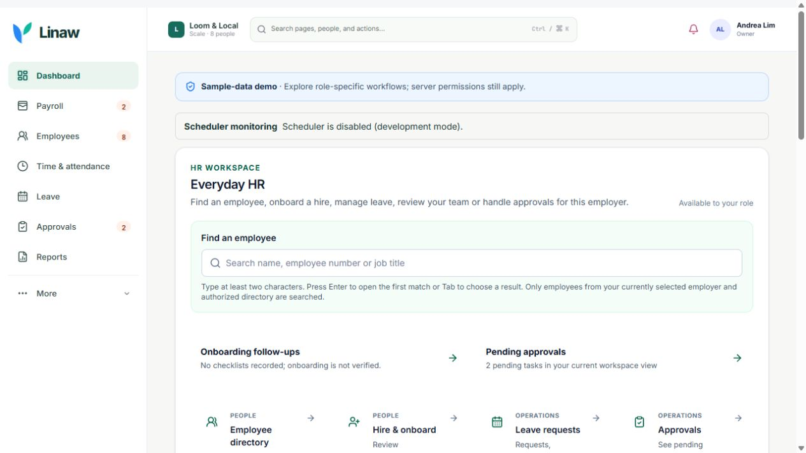
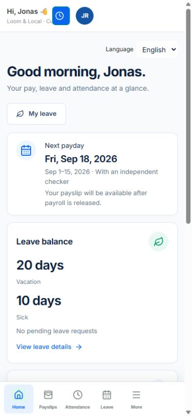
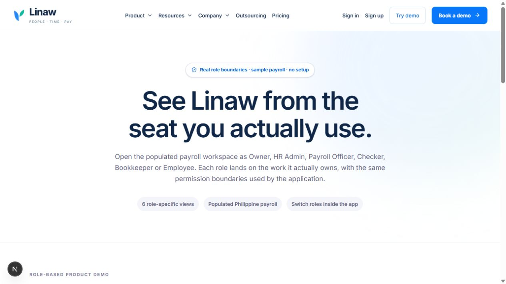
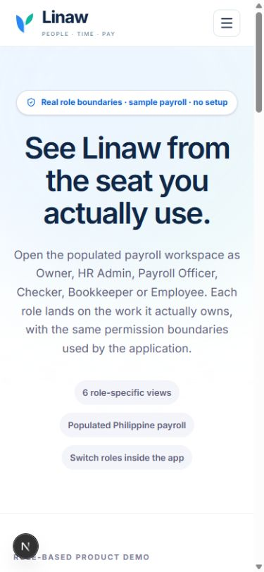

# Main-site demo routing — 2026-10-21

The public `/demo` page can redirect to the verified isolated fictional workspace at
`https://payrollph-fictional-demo-qa-three.vercel.app/demo`.
Existing marketing navigation and footer links continue to use `/demo`.

## Activation and rollback

- Default: `HOSTED_DEMO_NAVIGATION_ENABLED` absent or anything except exact `true` retains the existing role picker.
- After review and CI, set `HOSTED_DEMO_NAVIGATION_ENABLED=true` on the **main website project only** and deploy the reviewed source. Its `APP_BASE_URL` must be a valid HTTPS canonical URL.
- Leave this flag unset on `payrollph-fictional-demo-qa`. The helper also keeps the picker local when `APP_BASE_URL` has the QA origin, even if accidentally enabled.
- Rollback: unset/set the flag to `false` and redeploy. No database changes or data rollback are required.
- The destination is a source constant; neither query parameters nor forwarded request headers can choose an external redirect target.

## Executed behavior

`npx tsx --test tests/hosted-demo-navigation.test.ts tests/hosted-demo-page.test.ts`

Result: 5 passed, 0 failed. Tests execute the real page and Next.js redirect implementation, compare identical flag-off React element trees, exercise exact-true semantics, refuse invalid/missing canonical configuration, and prevent the QA canonical deployment from redirecting to itself. Only CSS loading is ignored by the Node test runner.

`npx tsc --noEmit`: exit 0.

`npm run lint`: `ESLint: 0 errors, 10 warnings; 0 warning baseline violations.`

Golden suites executed against a dedicated disposable local PostgreSQL database (no hosted/customer database):

| Command | Output |
| --- | --- |
| `npm run payroll:golden` | status passed; 83 scenarios; 0 failed |
| `npm run payroll:golden:phase2a` | status passed; 50 employee scenarios; journal debit/credit both 3762050 |
| `npm run payroll:golden:phase2b` | status passed; 8 cases |
| `npm run payroll:golden:pay-rules` | status passed; 4 certified families |

Full regression: `$env:TZ='Asia/Manila'; npm test` is pending completion; do not infer a passing result from the focused tests.

## Browser evidence

Local source with flag enabled served `GET /demo 307` to the fixed hosted picker. The Owner button entered the hosted Owner workspace; at 390px, selecting Employee entered Jonas Reyes's self-service workspace. Loading state `Opening…` was observed before both navigations completed.

With flag false, the same local source served `GET /demo 200`, stayed on the local origin, and displayed the existing six-role picker at desktop and 390px.

Local tooling caveat: the shared installed dependency is Next 16.3.8 while package.json requests 16.4.2. Turbopack needed a temporary root override to resolve the existing node_modules junction. The override was removed after browser checks and is not part of this PR. CI must validate the pinned dependency installation.

## Not done

- Passing full regression receipt and final CI review.
- Merge and main-project flag activation/deployment.
- Post-deployment click from the main public website.
- Customer payroll, real disbursement, government submission, and physical-phone UAT are outside this routing change.
